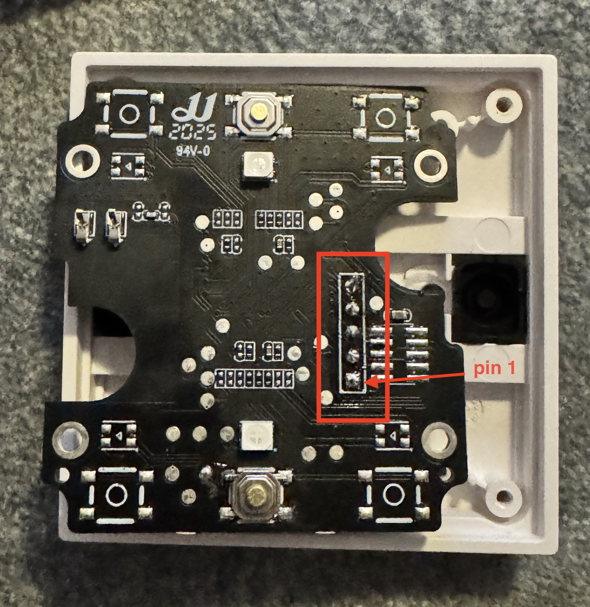

# SWD Flash Tool for H2 (EFR32MG24)

Flash custom bootloader + Zigbee firmware onto Aqara H2 switch boards via the exposed SWD pads using OpenOCD and any SWD probe.

## Prerequisites

- [OpenOCD](https://openocd.org/) 0.12.0+ (`brew install open-ocd`)
- Any SWD probe: Pico with [debugprobe](https://github.com/raspberrypi/debugprobe), J-Link, ST-Link, etc.

## Wiring

The programming header is on the back of the board (5-pin, pin 1 is the square pad):



| Pin | Signal | Connect to |
|-----|--------|------------|
| 1 (square) | 3V3 | Probe 3V3 |
| 2 | SWDIO | Probe SWDIO |
| 3 | SWCLK | Probe SWCLK |
| 4 | nRST | — (not needed) |
| 5 | GND | Probe GND |

The header is 2.54mm pitch — a pogo pin adapter can be used for solderless programming. Both 3.3V — no level shifting needed.

**Important:** Disconnect the relay module before programming to avoid back-powering the board from two sources.

For a Pico running debugprobe firmware, the default SWD pins are GP2 (SWCLK) and GP3 (SWDIO).

## Updating firmware binaries

After rebuilding the bootloader/application:

```bash
cp ../bootloader/cmake_gcc/build/base/bootloader.bin firmware/bootloader.bin
cp ../h2_switch_1g/cmake_gcc/build/base/h2_switch_1g.bin firmware/application.bin
```

## Usage

```bash
# With CMSIS-DAP probe (picoprobe/debugprobe) — default
./flash.sh

# With J-Link
./flash.sh --interface jlink

# With ST-Link
./flash.sh --interface stlink

# Custom firmware paths
./flash.sh --bootloader path/to/bootloader.bin --application path/to/app.bin
```

**Warning:** The DCI device erase permanently wipes the stock Aqara firmware. There is no way to recover it.

## What it does

1. **DCI device erase** — clears debug lock + all flash via the Debug Challenge Interface
2. **MSC flash programming** — writes bootloader at `0x08000000` and application at `0x08006000` via the Memory System Controller registers
3. **Verify** — reads back and compares against the original binaries
4. **Reset** — starts the new firmware

## Setting up a Pico as a probe

1. Download [debugprobe.uf2](https://github.com/raspberrypi/debugprobe/releases)
2. Hold BOOTSEL while plugging in Pico, drag the `.uf2` onto the RPI-RP2 drive
3. Connect GP2 → SWCLK, GP3 → SWDIO, 3V3 → 3V3, GND → GND

## Technical notes

- OpenOCD 0.12.0 ships `efm32s2.cfg` with DCI procedures but the `efm32s2` flash driver is not compiled into the Homebrew binary. The `openocd_efr32mg24.cfg` config inlines the DCI procedures and implements MSC flash programming in pure Tcl as a workaround.
- EFR32MG24 is a Series 2 Group 23 device with flash at `0x08000000`, 8KB pages, and a Cortex-M33 with TrustZone. MSC registers are accessed via the Secure base (`0x40030000`).
